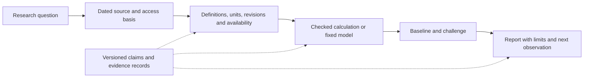

# Research map

The wider Portfolio Management project contains several related lines of work. This public edition selects reusable methods and reports while keeping the operational workspace separate. The map describes the design and publication scope; it does not imply every arrow is an automated runtime integration.

| Original area | Purpose | Public edition |
|---|---|---|
| Research lab | Acquisition, data contracts, historical checks, company and macro studies | Pure dated-join and numerical-boundary methods with synthetic tests. Network adapters and stores remain outside this edition. |
| Research skill lab | Controlled agent experiments, financial reconciliation and tracing | One edited case study, selected historical metrics and two calculation methods. |
| Research ontology | Separate lifecycle, evidence, authority, decision, freshness and admissibility; immutable records and derived views | Core contracts, policy, ledger, projection and verifier, with retained synthetic tests. |
| Research compiler | Turn evidence bindings and calculation plans into reviewable artifacts | Context only; not shipped as a complete public workflow. |
| Revenue forecasting | Compare fixed models with latest-value and seasonal baselines using dated company evidence | Next report candidate. The negative aggregate result was numerically reconstructed; the full public package is not included yet. |
| Energy and macro research | Mechanisms, operating analysis and central-bank monitoring | Future report-by-report review. This map makes no current market claims. |
| Portfolio and execution systems | Diagnostics, broker connections, quoting and operator controls | Outside this release. No personal positions or execution adapters are exported. |
| Research skills | Repeatable source, calculation and review procedures | A compact review workflow, without autonomous calls or publishing actions. |

## Why several claim states?

A claim can be active but untested, tested but contradicted in a particular sample, reviewed but expired, or blocked because necessary inputs are unavailable. A single `approved` status loses those distinctions.

The ontology models them separately. The ledger preserves events; graphs and context bundles are projections. Structural relationships do not automatically become claims of causation or predictive support. See [projection tests](../tests/research_ontology/test_projection.py) for exclusions and temporal behavior.

## Methods learned from licensed-data research

[Dated joins](../research_lab/wrds_dated_joins.py) originated in WRDS-related research. They match effective intervals while preserving overlaps, missing end dates and provenance. A match still leaves `historical_available_at` unknown and `backtest_eligible` false. All public records are invented.

[The momentum boundary](../research_lab/momentum_boundary.py) defines an inclusive relative deadband of `1e-12` using decimal input representations. Its lagged diagnostic compares endpoint prices known before the observation being evaluated. It is a numerical policy, not a return forecast or profitable strategy. Tests cover the boundary and causal alignment using synthetic prices.

These methods make lessons from private research inspectable without distributing observations, vendor-derived panels or captures. No licensed empirical performance claim is needed to demonstrate their behavior.

## Consolidation

The original workspace remains intact. Consolidation here means one front door, an edited report, shared examples and a distinction between reusable methods and historical experiments. It does not mean deleting failed runs or moving paths consumed by local tools.

Future additions should arrive one report at a time: a question, evidence, runnable calculation, result, limits and next decision. [The report index](../reports/README.md) tracks that sequence.
