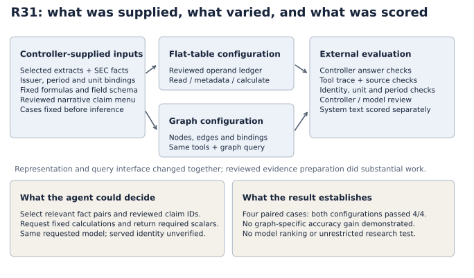

# Does a graph improve financial reconciliation?

**Result: no observed accuracy advantage over an equally source-bound flat table in four paired cases.** Both approaches passed all four cases. This is a small exploratory workflow comparison, not a claim about graphs in general.

Historical study: R31, October 14, 2026. Public edition: November 7, 2026.

## The problem

A financial answer can be arithmetically correct and compare the wrong things. A later filing may revise an earlier period. A nine-month figure is not a quarter. A table in thousands must not be interpreted as millions. A statement about total cash flow does not automatically apply to each component.

The experiment asked whether representing these relationships as a graph improved an agent's ability to reconcile supplied evidence. A useful comparison had to give the flat-table control the same source bindings, unit rules, fixed calculations and reviewed claim templates.

## What was compared

Each approach received the same bounded evidence and a calculation tool accepting a field identifier. The tool resolved operands from reviewed source cells, checked their hashes and units, and applied a fixed formula. The agent could not supply replacement numbers or a new formula.

The graph approach resolved nodes and edges and provided a graph-query interface. The flat control resolved a ledger of source-bound operands. Representation and query interface changed together, so this does not isolate a pure graph effect.

### Inputs, agent choices and evaluator responsibilities



| Part of the workflow | Responsibility and boundary |
|---|---|
| Evidence preparation | The controller selected filing extracts and SEC facts, bound issuer/period/unit meanings, and supplied fixed calculation definitions and reviewed narrative templates. The agent did not independently assemble an unrestricted filing corpus. |
| Candidate inputs | Both configurations received bounded source evidence and tool contracts. The flat configuration received a reviewed operand ledger; the graph configuration received nodes, edges and bindings. Controller answer keys were separate evaluation material. |
| Agent decisions | Select relevant fact pairs and reviewed claim IDs, request allowed calculations, and return required scalar values. The calculator accepted field IDs, not replacement operands or formulas. |
| System output | Availability values, narrative wording, citation locators and explanatory text were system-produced. Correct system text cannot be counted as independently authored model reasoning. |
| Evaluation | The controller checked answers, source/tool traces and identity/unit/period constraints. A separate model review checked narrative templates before benchmark inference. This was not independent human ground truth. |

All eight benchmark receipts requested `gpt-6-luna`; the provider-served identity was not independently verified. This compares two configurations of the same requested model, not different model families. The graph arm also required a graph query. The implementations are not identical in every safeguard: the graph checks explicit semantic contracts, while the flat calculation depends more heavily on its reviewed ledger.

The diagram is a retrospective explanation of the saved workflow, not a new experiment. These preparation choices make the task narrower and more reproducible, but they also limit how much of the successful outcome can be attributed to the agent.

| Cohort | Company and period | Flat bound | Graph |
|---|---|---|---|
| Development | Applied Materials FY2018 Q1 | Pass | Pass |
| Development | II-VI FY2017 Q3 | Pass | Pass |
| Fresh comparison | Applied Materials FY2017 Q3 | Pass | Pass |
| Fresh comparison | II-VI FY2016 Q1 | Pass | Pass |

There was one episode per case and approach: eight episodes, not eight independent companies. The fresh cases were frozen before those episodes but came from the same issuers, with comparative overlap. They are not protected holdouts. Historical identifiers use `COHR` for the II-VI case and `literal` for the flat control; these labels remain in the metrics for traceability.

## Results and cost observations

| Measure | Flat bound | Graph |
|---|---:|---:|
| Full passes | 4 / 4 | 4 / 4 |
| Uncached input tokens | 117,181 | 147,446 |
| Sum of episode durations, seconds | 39.95 | 48.61 |

Across eight episodes, the saved evaluation records 98/98 correct model-owned scalar values, 26/26 correct system-owned availability values, and 32 accepted system-template narrative selections. These are distinct categories; system-generated wording is not unaided model prose accuracy.

The flat control used fewer uncached input tokens and less summed episode time in this sample. Cache effects, sequencing, query-tool burden and the small sample prevent a general cost ranking. Billed dollars and preparation/review labor are unknown. Episode duration is not total project wall time.

The benchmark and three template-review calls, including the preceding failed review, total 11 model calls, 903,586 input tokens and 6,759 output tokens. Requested model identity was recorded; served identity was not independently verified.

## The failure that belongs in the report

R30 stopped before benchmark inference because a separate template reviewer rejected two II-VI claims. R31 added explicit registrant evidence and labeled a nine-month-minus-quarter calculation as a derivation. It preserved the distinction between unchanged total operating cash flow and changed components.

Subsequent acceptance is evidence about the corrected, constrained workflow. It does not erase the failed review or establish that an unrestricted model would write accurate claims. The separate reviewer used the same model family and controller-selected excerpts, so correlated errors remain possible. This was not independent human review.

## Inspect the mechanism

```sh
python3 -m examples.reconciliation_demo
```

This newly authored example uses invented revenue of 100 and 110 million for the same period. It calls the retained historical calculators, checks the $10 million difference independently with `Fraction`, and demonstrates that changing the source breaks both calculations. It illustrates the mechanism; it is not a replay of the historical model episodes or real filing figures.

The [tests](../../tests/test_public_calculators.py) also challenge caller-supplied operands, changed formulas and a mismatched reporting period. The graph has explicit semantic contract checks; the flat implementation relies more heavily on its reviewed ledger. Neither can prove that a human or controller initially bound the correct source meaning. A matching hash checks bytes, not truth.

## Evidence and reproducibility boundary

Run `python3 -m scripts.summarize_reconciliation` to recompute the table from [episode metrics](episode-metrics.json). [Provenance](provenance.json) records source artifact hashes and the checks made against saved episode receipts. The publication check verified usage, time, trace status and mechanical status. Source-semantic decisions remain historical review evidence; they were not independently repeated for this export.

Fresh-case filing links: [Applied Materials FY2017 Q3](https://www.sec.gov/Archives/edgar/data/6951/000000695117000026/amat0730201710-qq32017.htm) and [II-VI FY2016 Q1](https://www.sec.gov/Archives/edgar/data/820318/000156459015009922/iivi-10q_20150930.htm). Captures were web text representations, not retained original HTML/XBRL contexts. The next-calendar-day filing convention was an approximation, not verified first-public timing.

This edition includes selected study metadata and a synthetic demonstration. It does not include all original prompts, captures, answer keys or traces, so it does not support full independent replay of the historical benchmark. No WRDS data is included in these artifacts.

## What follows

The result favors keeping the simple baseline in view. A useful next experiment would ask which downstream conclusions a source revision affects, or whether an answer used evidence available at a particular date. A graph could help, but table joins remain a serious baseline. Equivalent evidence, equal tool capabilities, frozen cases and measured preparation effort would be necessary for a stronger comparison.

This study establishes bounded workflow behavior. It does not establish forecast usefulness, trading returns, general agent reliability or owner mastery.
