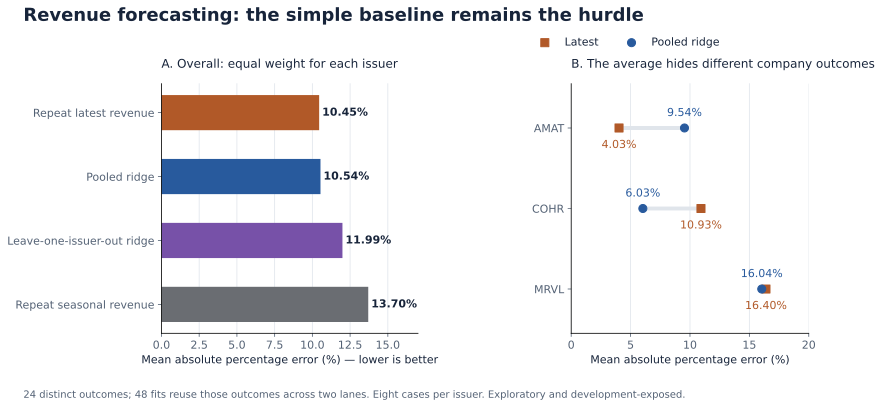
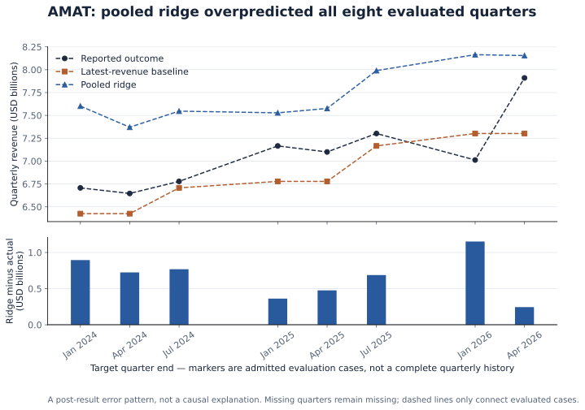

# Does a peer-revenue model beat repeating the latest revenue?

**The fixed pooled model did not beat the latest-available-revenue baseline overall.** Its average absolute percentage error was 10.54%, compared with 10.45% for the baseline. The issuer breakdown reveals a larger AMAT error and a better COHR result. This is an exploratory, development-exposed study; it does not establish predictive skill on an untouched test set.

Historical experiment: October 12, 2026. Public numerical replay: November 7, 2026. This is a fixed statistical model, not an experiment comparing LLM forecasters.

## Reproduce the calculations

From the repository root, with Python 3.10+ and no extra packages:

```sh
python3 -m scripts.replay_revenue_forecast
```

The command validates the admitted case dates and frozen training IDs, recomputes all 48 fits, compares them with the saved predictions, and prints per-company and aggregate errors. It makes no network requests and does not modify the records. The new standard-library implementation matches the saved predictions to approximately 1.82e-12 million USD, numerical rounding only. The [verification record](verification.json) preserves the checked scope.

## The result to explain visually



| Method | Equal-issuer MAPE | Equal-issuer MAE, USD millions |
|---|---:|---:|
| Repeat latest available revenue | **10.45%** | **243.34** |
| Pooled ridge | 10.54% | 326.09 |
| Leave-one-issuer-out ridge | 11.99% | 417.14 |
| Repeat corresponding prior-year fiscal quarter | 13.70% | 322.71 |

MAPE averages absolute error divided by actual revenue, expressed as a percentage. MAE averages the absolute dollar error. Each issuer receives equal aggregate weight, and each has eight evaluation cases. Dollar errors remain sensitive to company size.

The left panel compares the four methods. The right panel shows that the aggregate result conceals different company outcomes: pooled ridge worsens AMAT's percentage error, improves COHR's, and changes MRVL's little. Selecting COHR after seeing the result would be a new exploratory decision, not independent confirmation of a successful model.

There are 68 admitted forecasting cases built from 86 original quarterly observations. The two training approaches reuse the same 24 evaluation outcomes: eight each for Applied Materials, Coherent/II-VI and Marvell. **Forty-eight fitted models are not 48 independent outcomes.** The selected periods are not a continuous quarterly series; missing standalone quarters remain excluded.

## What the model knows and predicts

Each forecast origin is the day before the target fiscal quarter starts. Two revenue quantities are known under the study's availability convention:

- **Latest:** the most recent admitted standalone quarter available by the origin. It can be older than the immediately preceding quarter.
- **Seasonal:** the matching native fiscal quarter in the previous fiscal year, also available by the origin.

The feature is `seasonal / latest`; the training target is `target / latest`. The feature is standardized using training cases only. A one-feature ridge regression with penalty 1 and an unpenalized intercept predicts the ratio, which is multiplied by the latest revenue to recover dollars. No issuer indicator, additional predictor or post-result tuning is added.

Pooled fits use eligible history across all three issuers. Leave-one-issuer-out fits exclude every training case belonging to the target issuer. Both require earlier training origins and target labels available by the evaluation origin. Each fit has 22–63 training cases. The [design](design.json) records the fixed selection rules, and the [split](frozen-split.json) lists every training case ID.

## One forecast, reconstructed

For AMAT's quarter ending January 28, 2024, the forecast origin was October 29, 2023. Its pooled fit used 43 eligible training cases.

| Quantity | Value | Relevant date |
|---|---:|---|
| Latest available quarterly revenue | $6.425bn | Quarter ended July 30, 2023; filed August 24 |
| Corresponding prior-year quarter | $6.739bn | Quarter ended January 29, 2023; filed February 23 |
| Pooled prediction | $7.602bn | Calculated using the frozen October 29 origin |
| Original reported target | $6.707bn | Quarter ended January 28, 2024; filed February 27 |

The latest baseline missed by $282m, the seasonal baseline by $32m, and ridge by approximately $895m. The fitted ratio can raise the forecast above both reference amounts; the model is not simply averaging those two revenues.

This example also separates quarter end, filing date and information availability. The study assumes availability one calendar day after filing. A number describing an earlier quarter is not automatically information that was available at that quarter's end. Later revisions cannot be inserted into earlier model inputs without changing the information set. A study targeting revised outcomes would need to declare that target separately.

## An error pattern, not yet a causal explanation



Every evaluated AMAT pooled prediction exceeds its reported outcome. Mean overprediction is approximately $664m. The leave-one-issuer-out approach also overpredicts all eight AMAT outcomes, by approximately $923m on average.

This identifies a calibration problem worth investigating. It does not show whether the cause is donor-company growth, the fitted intercept, acquisitions, accounting differences or another mechanism. Dashed lines only connect admitted cases; missing quarters have not been interpolated. The figure is a post-result diagnostic, not a preregistered causal test.

## Inputs and publication boundaries

The numerical inputs come from public SEC company-facts captures and filing metadata. The SEC states that public EDGAR filing content may be accessed and reused; see its [reuse policy](https://www.sec.gov/about/webmaster-frequently-asked-questions). No WRDS observations, private holdings or credential material are included.

Before publication, all 204 latest/seasonal/target references were matched to 86 distinct facts in retained SEC captures. Value, dates, accession, form and fiscal metadata were checked, preserving documented fiscal-year adjudications. Capture hashes matched the original source ledger. [SEC source references](sec-sources.json) include capture hashes, fact pointers and filing URLs.

The [cases](cases.json), [frozen split](frozen-split.json) and [saved predictions](predictions.json) are unchanged copies of the selected numerical artifacts. Cases preserve original accessions, source concepts, filing dates, assumed availability and accounting regimes. Where an API fiscal year required adjudication, both the API year and the retained corrected year remain visible. Values are in USD in cases and USD millions in predictions.

This release includes enough data to reproduce fitting and scoring from admitted cases. It does **not** include every original HTML capture, full API snapshot, rejected source candidate or historical admission script. It therefore does not independently replay the entire source-selection process. [Provenance](provenance.json) records source artifact hashes and publication transformations. Source hashes show byte consistency, not authenticity or economic correctness.

The [SEC API documentation](https://www.sec.gov/search-filings/edgar-application-programming-interfaces) explains that the API data changes as filings arrive. Array pointers here refer to the retained snapshots, not necessarily today's API arrays. A current lookup should match accession, concept, period and value rather than assume a stable array index.

## What limits the conclusion

- The historical first-public timestamps and historical API-vintage completeness are unverified. Filing date plus one calendar day is a proxy, not exact point-in-time proof.
- The three surviving issuers were user-selected, and earlier development exposed some outcomes. The evaluation is not a protected holdout; no statistical-significance or generalization claim follows.
- Features and targets within a case must share an accounting regime. The historical preparation rejected four AMAT and three Coherent transition-straddling cases. Pooling ratios across different issuers and regimes still assumes transferability; acquisitions and business-mix changes remain risks.
- The source review excluded inaccessible originals and missing standalone quarters instead of deriving or zero-filling them. That selection can affect the result. The public replay does not establish that every exclusion was optimal.
- Earlier V1/V2 attempts stopped before fitting. V3 added reviewed legacy observations before fitting under the unchanged model and coverage requirements. Those versions are not independent successful replications.
- The result does not establish trading returns, forecasts for other issuers or an ability to choose winners after inspecting errors.

The appropriate decision is to retain the simple baseline and investigate the AMAT miss before promoting this specification. A useful next collaboration would inspect donor growth ratios and the fitted intercept, then freeze any changed specification before genuinely new outcomes. That would be a new experiment; it would not replace this result.
